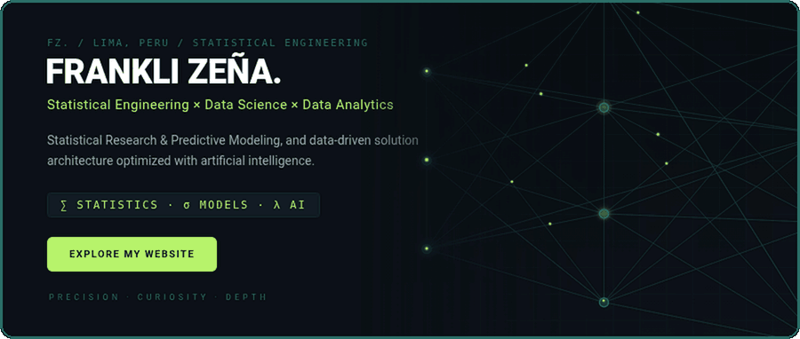

  

  

  
  
  
  
  
  

  

<h3 id="about">📌 About</h3>

  Statistical Engineering student at the National University of Engineering (UNI), focused on Data Science and Data Analytics.
  I enjoy transforming data into meaningful insights and developing solutions for real-world problems.
  My interests include <b>statistical modeling, predictive analytics, fraud detection, geospatial analysis and applied artificial intelligence</b>.

  Beyond the technical side, I participate in university leadership and student representation, strengthening my communication, collaboration and problem-solving skills.

  <code>&gt; Committed to analytical rigor, continuous learning and creating value through data.</code>

  

<h3 id="portfolio">🚀 Portfolio</h3>

  

  

<h3 id="now">🔭 Right now</h3>

  
  
  

  

<h3 id="stack">🛠️ Stack</h3>

  
  
  
  
  

  
  
  
  
  

  

<h3 id="activity">📈 Activity</h3>

  
  

  

  

<h3 id="contact">📫 Contact</h3>

  
  
  
  

  <i>Learning deeply, one dataset at a time.</i>

  

